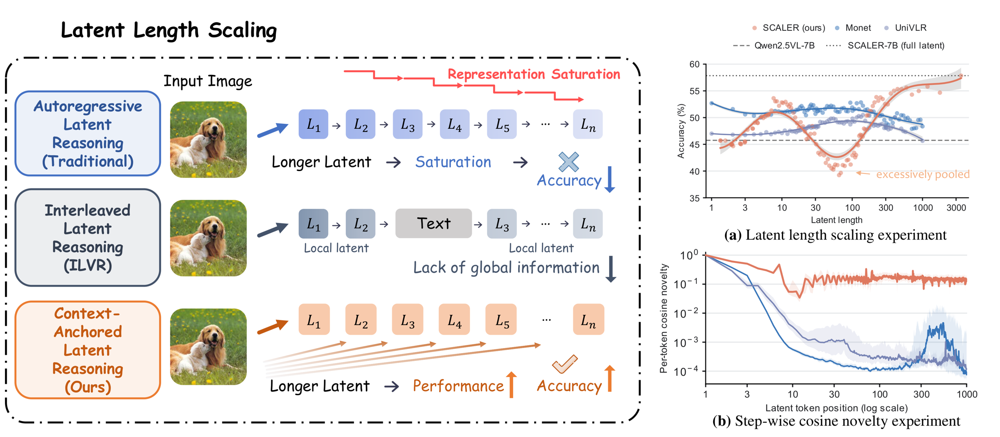
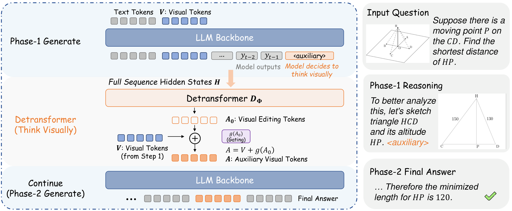
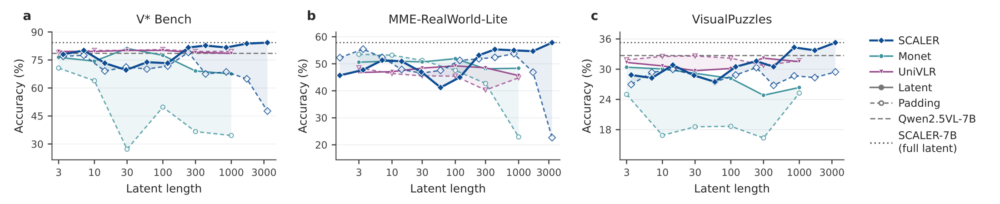

<h1 align="center">SCALER</h1>

<strong>Breaking the Latent Scaling Bottleneck via Single-Pass Context-Anchored Latent Visual Reasoning</strong>

  Chenfeng Wang1,2 · Wei Zhai1,† · Wei He2 · Xuhan Zhu2 · Chunpeng Zhou2 
  Song Yan1 · Qizhen Li2 · Zeyu Zhang1,2 · Shuai Guo1,2 · Yufei Zheng1,2 
  Chengjun Yu1,2 · Fan Lu1 · Yang Cao1 · Pengfei Yu2,† · Zheng-Jun Zha1

  1 University of Science and Technology of China · 2 Li Auto Inc. 
  <em>† Corresponding authors</em>

  
  
  
  

## Abstract

  

<em>Motivation: single-pass, context-anchored visual latents preserve visual evidence and sustain high representational novelty as the latent sequence grows.</em>

Evaluating visual latent reasoning across task complexity and sequence length reveals a fundamental **Latent Scaling Bottleneck**: existing autoregressive methods yield modest gains only within short budgets ($\le 30$ tokens) on simple tasks, yet stagnate or degrade on complex tasks and longer sequences due to **Latent Representation Saturation** and **Over-Compressed Supervision Targets**.

We propose **SCALER** (**S**ingle-Pass **C**ontext-**A**nchored **L**at**e**nt Visual **R**easoning), which introduces a lightweight *detransformer* that synthesizes spatially aligned auxiliary visual tokens from full-sequence hidden states **in a single forward pass**, anchoring each token to the original visual space. Coupled with a three-stage SFT curriculum and **ALPO** (**A**uxiliary **L**atent **P**olicy **O**ptimization) for differentiable reinforcement learning, SCALER extends effective latent length by over **30×**, sustains high step-wise cosine novelty across **1,000+ tokens**, and achieves state-of-the-art open-source performance across high-resolution perception, real-world reasoning, and out-of-distribution visual logic benchmarks.

## 📢 News
* **[Upcoming]** 🚀 **Training Code & Model Checkpoints** will be released soon.
* **[2026-11-24]** 📄 Our Paper is released on [arXiv](https://arxiv.org/pdf/2605.12163).
* **[2026-11-20]** 💻 Evaluation/Inference Code is released.

## Inference Pipeline

  

<em>Method: SCALER autonomously triggers auxiliary generation, synthesizes an image-aligned visual block in one forward pass, and resumes reasoning.</em>

1. **Phase-1 Generate.** The VLM backbone processes the input image and question, autonomously emitting `<auxiliary>` when fine-grained visual reasoning is needed.
2. **Detransformer (Think Visually).** A lightweight two-layer detransformer maps full-sequence hidden states in a single forward pass to visual editing tokens $A_0$, which are residually fused with the original visual features: $A = V + g(A_0)$.
3. **Phase-2 Generate.** The language model resumes decoding conditioned on the injected auxiliary visual tokens $A$ to produce the final answer.

## Main Results

Overall accuracy (%) across five perception, real-world reasoning, and out-of-distribution (OOD) visual logic benchmarks:

| Model | V*Bench | HRBench-4K | HRBench-8K | MME-RealWorld-Lite | VisualPuzzles (OOD) |
| :--- | ---: | ---: | ---: | ---: | ---: |
| GPT-4o | 67.50 | 65.00 | 59.60 | 45.25 | 41.30 |
| GPT-6-luna | 76.44 | 72.75 | 66.25 | 47.37 | 42.38 |
| Qwen2.5-VL-7B (Backbone) | 78.53 | 71.50 | 63.75 | 45.75 | 32.71 |
| LVR | 81.15 | 69.50 | 62.25 | 49.66 | 28.51 |
| Monet | 83.77 | 73.13 | 67.13 | 52.63 | 28.34 |
| HyLaR | 80.10 | 73.25 | **69.38** | 52.74 | 30.05 |
| LASER | 76.96 | 73.25 | 66.13 | 50.96 | 35.10 |
| UniVLR | 82.70 | 73.30 | 68.80 | 50.70 | 32.53 |
| SCALER-SFT (Ours) | 82.72 | 74.25 | 66.75 | 52.84 | 34.16 |
| **SCALER-7B (Ours)** | **84.29** | **75.25** | 68.88 | **57.84** | **35.27** |
| *Gain over backbone* | *+5.76* | *+3.75* | *+5.13* | *+12.09* | *+2.56* |

On **MME-RealWorld-Lite**, SCALER-7B improves over the Qwen2.5-VL-7B backbone by **+12.09%** and surpasses proprietary GPT-6-luna by **+10.47%**. On **HRBench-8K**, SCALER-7B also leads Fine-grained Cross-instance Perception (FCP) at **61.25%** (**+10.0%** over HyLaR's 51.25%). Full sub-task breakdowns are available on the [project page](https://bonjour-codedev.github.io/SCALER/).

### Latent Length Scaling & Meaningless Padding Analysis

  

Comparing normal inference (solid curves) with meaningless padding replacement (dashed curves) shows that restoring spatial resolution ($K \ge 100$ to full latent length) unlocks sustained accuracy gains and a wide semantic gap over padding across V*Bench, MME-RealWorld-Lite, and VisualPuzzles.

## Quick Start

We recommend **Python 3.12 on Linux with an NVIDIA GPU** (validated with PyTorch 2.7.1, CUDA 12.6, Transformers 4.57.1, and FlashAttention 2.8.3).

~~~bash
git clone https://github.com/Bonjour-CodeDev/SCALER-Code.git
cd SCALER-Code

python3.12 -m venv env
source env/bin/activate
python -m pip install -r inference/requirements.txt
python -m pip install packaging ninja wheel
python -m pip install flash-attn==2.8.3 --no-build-isolation
python -m pip install -e . --no-deps
~~~

See the [inference guide](inference/README.md) for prebuilt FlashAttention wheel installation and optional SDPA configuration.

### Run Examples

~~~bash
# Dog coat color
python inference/run.py --model /path/to/checkpoint \
  --case inference/examples/dog.json \
  --output outputs/dog.json

# Counting overlapping bicycles in HRBench-8K
python inference/run.py --model /path/to/checkpoint \
  --case inference/examples/hrbench8k_bicycles.json \
  --output outputs/bicycles.json
~~~

| Example | Question | Model Output |
| :--- | :--- | :--- |
| `dog.json` | “what's the color of the dog” | **tan** |
| `hrbench8k_bicycles.json` | “How many bicycles are visible near the building's entrance?” | **C — Three** |

Run on custom images and questions:

~~~bash
python inference/run.py --model /path/to/checkpoint \
  --image /path/to/image.png \
  --question "What is happening in this image?" \
  --output outputs/my-case.json
~~~

The JSON output records the extracted answer, full response, token IDs, auxiliary trigger status, latent token count, and runtime statistics.

### Default Inference Settings

| Setting | Default |
| :--- | :--- |
| Decoding | Greedy (`temperature=0`, `do_sample=False`) |
| Auxiliary generation | Autonomous `<auxiliary>` trigger, full-resolution native latent sequence |
| Text token budget | 512 tokens in Phase 1; 512 tokens in Phase 2 |
| Precision / attention | BF16 / FlashAttention 2 |
| Image resolution bounds | `min_pixels=3136`, `max_pixels=4194304` |

Pass `--temperature 1 --seed 2026` to enable stochastic sampling (`top_p=1`, `top_k=0`).

## Benchmark Evaluation

Follow the [evaluation guide](eval/README.md) to install evaluation dependencies and prepare the five benchmarks:

~~~bash
python -m pip install -r eval/requirements.txt
python -m pip install -e eval/lmms-eval --no-deps

python eval/lmms-eval/prepare_data.py \
  --manifest datasets.json --output data/prepared

CUDA_VISIBLE_DEVICES=0 python eval/lmms-eval/run_scaler.py \
  --model /path/to/checkpoint \
  --data data/prepared --output outputs/eval

python eval/lmms-eval/score_scaler.py \
  --data data/prepared --output outputs/eval
~~~

| Benchmark | Test Samples |
| :--- | ---: |
| V*Bench | 191 |
| HRBench-4K | 800 |
| HRBench-8K | 800 |
| MME-RealWorld-Lite | 1,919 |
| VisualPuzzles-direct | 1,168 |
| **Total** | **4,878** |

Multi-GPU and multi-node evaluation are supported via `--shards N --shard <idx>`, with automatic resume for interrupted shards.

## Repository Layout

~~~text
SCALER-Code/
├── scaler/                 # Core preprocessing, two-phase generation, and detransformer modeling
├── inference/
│   ├── run.py              # Standalone image/question inference runner
│   ├── examples/           # Included examples (dog.json, hrbench8k_bicycles.json)
│   └── requirements.txt
├── eval/
│   ├── lmms-eval/          # Five-benchmark evaluation suite and SCALER adapter
│   └── requirements.txt
└── tests/                  # Unit and GPU verification scripts
~~~

## Verification

~~~bash
python -m unittest discover -s tests -p 'test_*.py' -v
~~~

Additional GPU verification scripts are documented in [tests/README.md](tests/README.md).

## Citation

~~~bibtex
@misc{wang2026scalerbreakinglatentscaling,
      title={SCALER: Breaking the Latent Scaling Bottleneck via Single-Pass Context-Anchored Latent Visual Reasoning}, 
      author={Chenfeng Wang and Wei Zhai and Wei He and Xuhan Zhu and Chunpeng Zhou and Song Yan and Qizhen Li and Zeyu Zhang and Shuai Guo and Yufei Zheng and Chengjun Yu and Fan Lu and Yang Cao and Pengfei Yu and Zheng-Jun Zha},
      year={2026},
      eprint={2605.12163},
      archivePrefix={arXiv},
      primaryClass={cs.CV},
      url={https://arxiv.org/abs/2605.12163}, 
}
~~~

## License and Acknowledgments

This project is released under the [MIT License](LICENSE). SCALER builds upon [Qwen2.5-VL](https://github.com/QwenLM/Qwen2.5-VL) and [lmms-eval](https://github.com/EvolvingLMMs-Lab/lmms-eval). Original MIT and Apache-2.0 licenses are preserved in their respective components; see [THIRD_PARTY_NOTICES.md](THIRD_PARTY_NOTICES.md).
